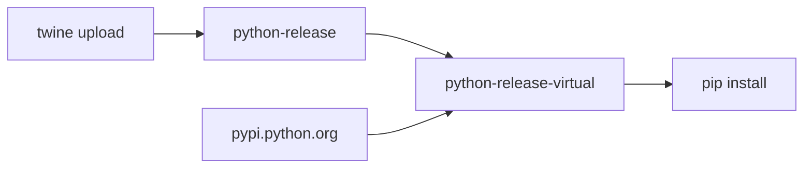

# Release Guide

How to build and publish a new `paradox-scim2-models` version to the Workday Artifactory PyPI repository.

## Repositories: upload vs. download

Packages are uploaded to `python-release` but installed from `python-release-virtual`.

| Repository | Type | Purpose |
| --- | --- | --- |
| `python-release` | Local | Stores the published packages. This is the only deployment target. |
| `python-release-virtual` | Virtual | Read-only aggregate of `python-release` and `pypi.python.org`. Used for installing packages. |

- A virtual repository only gives a unified view of its constituent repositories; it cannot be deployed to.
- Once a package is in `python-release`, it is automatically available through `python-release-virtual`. No manual promotion step is needed.
- Consumers need a single index URL to resolve both internal packages (such as `paradox-scim2-models`) and external PyPI dependencies.



## Prerequisites

- Python >= 3.9
- Access to the Artifactory service account (`svc-paradox-sunny`) and its encrypted password (`<ENCRYPTED_PASSWORD>`)
- Tools: `twine` and a build frontend

```bash
brew install twine
python -m pip install build
```

## 1. Configure Artifactory credentials (one-time)

Create or open `~/.pypirc`:

```bash
nano ~/.pypirc
```

Add the following block. Replace `python-release` with your target repository key if different, and `<ENCRYPTED_PASSWORD>` with your encrypted password (`ABC...`):

```ini
[distutils]
index-servers =
    workday

[workday]
repository = https://artifactory.workday.com/artifactory/api/pypi/python-release
username = svc-paradox-sunny
password = <ENCRYPTED_PASSWORD>
```

Restrict the file permissions so the token is not readable by other users:

```bash
chmod 600 ~/.pypirc
```

> Never commit `~/.pypirc` or the token to the repository.

## 2. Bump the version

Update `version` in [pyproject.toml](pyproject.toml), e.g. `0.3.3` -> `0.3.4`, and commit the change. Artifactory release repositories typically reject re-uploads of an existing version.

## 3. Build the package

From the repository root:

```bash
rm -rf dist/
python -m build
```

This produces the wheel and sdist in `dist/`, for example:

```
dist/paradox_scim2_models-<version>-py3-none-any.whl
dist/paradox_scim2_models-<version>.tar.gz
```

Optionally validate the artifacts:

```bash
twine check dist/*
```

## 4. Upload via Twine

Reference the server name (`workday`) defined in the `[distutils]` section of `~/.pypirc`:

```bash
twine upload -r workday dist/paradox_scim2_models-<version>-py3-none-any.whl
```

Example for version `0.3.3`:

```bash
twine upload -r workday dist/paradox_scim2_models-0.3.3-py3-none-any.whl
```

## 5. Verify

- Twine reports the upload at 100% and returns an HTTP `200 OK` or `201 Created` response.
- The new version is visible in Artifactory under `python-release-virtual`.
- Optionally confirm installation from a clean virtualenv, as described in [Installing the package](#installing-the-package).

## Installing the package

Consumers install from the virtual repository, not from `python-release`.

This project uses [`uv`](https://docs.astral.sh/uv/) for package management.

1. Point `uv` to `python-release-virtual` in `pyproject.toml`

    ```toml
    [[tool.uv.index]]
    name = "internal"
    url = "https://<workday-artifactory-host>/artifactory/api/pypi/python-release-virtual/simple"
    default = true
    ```

2. Install the package:

   ```bash
   uv add paradox-scim2-models==<version>
   ```

For `pip` users, set `index-url` in `pip.conf` (`~/.config/pip/pip.conf`) to the same URL and add `trusted-host = artifactory.workday.com`.

> Do not commit credentials or a `pip.conf` containing them to the repository.

## Troubleshooting

| Symptom | Likely cause |
| --- | --- |
| `401 Unauthorized` / `403 Forbidden` | Invalid or expired token, or the account lacks deploy permission on the repository |
| `409 Conflict` / "already exists" | The version was already published; bump the version and rebuild |
| `InvalidDistribution` from `twine check` | Metadata problem in `pyproject.toml`; fix and rebuild |
| `Repository 'workday' not found` | Missing `[workday]` section or wrong name in `~/.pypirc` |
